# Guia de estilos

A fábrica vem com a nossa cara: papel claro, azul em bloco, amarelo de marcador, borda
grossa e sombra dura. Para os seus vídeos saírem com a sua, escolha um estilo deste guia,
tire as cores no Coolors e cole um pedido no seu agente de IA. Ele monta a pasta `marca/`,
e todo vídeo dali pra frente sai nela, das peças à capa.

Cada estilo é uma linguagem inteira, não só outra paleta: muda a letra, a borda, a sombra,
o canto, o fundo e o jeito de destacar a palavra. As peças são as mesmas; a cara delas é
que muda. A própria fábrica desenhou cada quadro abaixo: à esquerda uma peça de lista, à
direita o gancho e o crachá por cima de um vídeo.

## Os doze estilos

| Estilo | Chão | Letra | Borda e sombra | Combina com |
|---|---|---|---|---|
| Neobrutalista | claro, pontilhado | sem serifa, pesada | grossa, sombra dura | quem ensina, tecnologia, serviço direto |
| Editorial | papel liso | serifada leve, destaque em itálico | nenhuma, só um filete em cima | consultoria, finanças, quem fala muito na câmera |
| Tech | escuro, em grade com brilho | sem serifa firme e monoespaçada | filete fino, luz em volta | programação, automação, software |
| Retrô | creme com sol de raios | serifada gorda e redonda | nenhuma, sombra em duas faixas de cor | comida, café, loja de bairro, música |
| Pop | cor viva com bolhas | redonda, bem gorda | nenhuma, sombra macia | criança, festa, doce, pet |
| Luxo | preto liso | serifada clássica leve | filete dourado, sem sombra | moda, joia, estética, imóvel |
| Cyberpunk | roxo-preto com varredura | angulosa em caixa alta | filete, sombra dobrada em duas cores | games, tecnologia, música eletrônica |
| Pixel | azul-noite com pontos | letra de pixel | borda em degrau, sombra preta seca | games, nerd, curiosidade |
| Quadrinhos | papel jornal com retícula | letra de balão | contorno preto grosso, sombra dura | humor, cultura pop, quem conta história |
| Vaporwave | céu roxo, sol listrado e grade | larga e espaçada | filete ciano, sombra rosa | música, moda de rua, estética |
| Lousa | quadro verde com pó de giz | escrita à mão | contorno de giz torto, sem sombra | professor, curso, explicação |
| Colagem | papel pardo com faixa rasgada | preta bem gorda | papel colado com fita, sombra de papel | arte, artesanato, moda, criativo |

O movimento é o mesmo em todos: a peça cai e assenta, e o destaque aparece depois da
última palavra. Sem sombra, a peça só assenta, sem o pouso.

### Neobrutalista

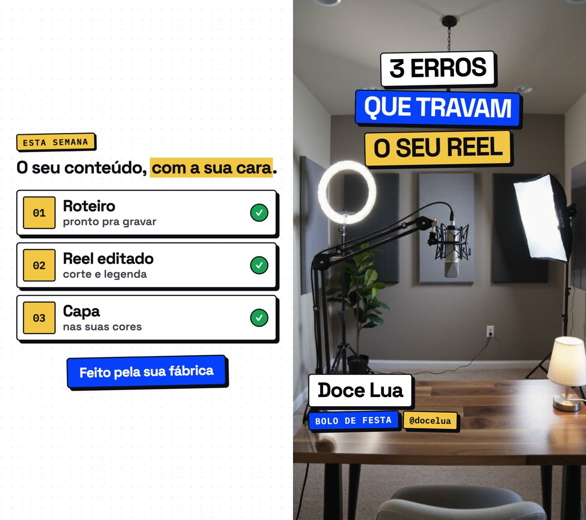

É o nosso, e é o que a fábrica usa se você não pedir nada. Papel branco, letra quase preta,
um bloco forte (o nosso é azul) e um marcador quente (o nosso é amarelo). A letra é a Space
Grotesk, pesada. Borda grossa, sombra dura sem desfoque, papel pontilhado.

```
adapta a fábrica pra minha marca, seguindo o docs/guia-de-estilos.md: estilo neobrutalista, cores #FFFFFF #0B0D12 #0640FB #F2C744, letra Space Grotesk. Sobre mim: <o que você vende, pra quem, e o seu jeito de falar em três palavras>
```

### Editorial

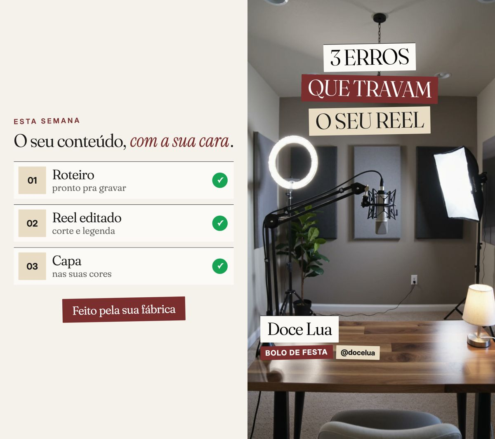

Cara de revista, com muito ar. Papel liso, título numa serifada leve (Fraunces) e o
destaque em itálico na cor do bloco. Nenhuma borda e nenhuma sombra: o cartão é só um
filete fino em cima. A etiqueta é texto espaçado, sem caixa. O bloco pede uma cor sóbria,
como vinho ou azul-marinho.

```
adapta a fábrica pra minha marca, seguindo o docs/guia-de-estilos.md: estilo editorial, cores #F5F2EB #1B1B1B #7A2E2E #E8DCC4, letra Fraunces. Sobre mim: <o que você vende, pra quem, e o seu jeito de falar em três palavras>
```

### Tech

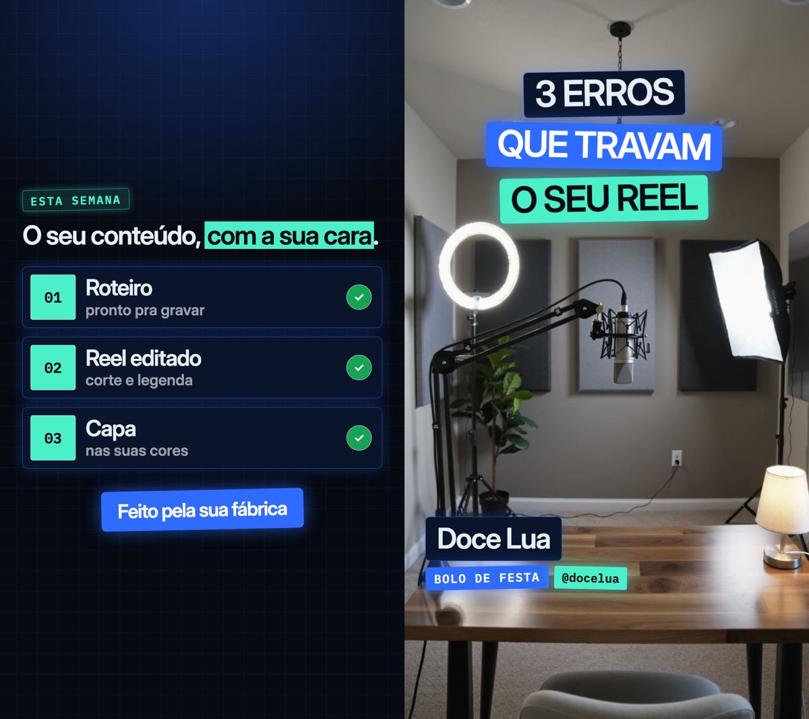

Tela de produto de software. Chão quase preto com grade fina e um brilho em cima, cartão
escuro com filete fino e luz em volta no lugar da sombra. Título na Inter, firme, e apoio em
monoespaçada. O marcador é uma cor neon.

```
adapta a fábrica pra minha marca, seguindo o docs/guia-de-estilos.md: estilo tech, cores #060A12 #E7EEF8 #2F6BFF #4BF0C8, letra Inter. Sobre mim: <o que você vende, pra quem, e o seu jeito de falar em três palavras>
```

### Retrô

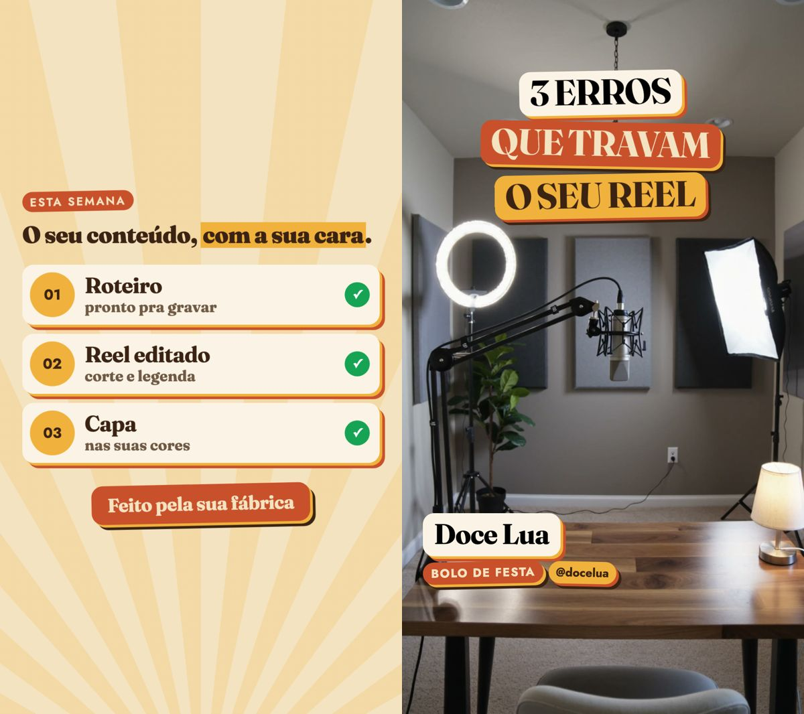

Anos 70, como placa de lanchonete. Creme, laranja queimado e mostarda, a Fraunces gorda e
redonda, canto bem redondo e nenhuma borda. A sombra vem em duas faixas de cor, e atrás
fica um sol de raios bem leve.

```
adapta a fábrica pra minha marca, seguindo o docs/guia-de-estilos.md: estilo retro, cores #F4E3C1 #3B2314 #C8512B #F0B23C, letra Fraunces. Sobre mim: <o que você vende, pra quem, e o seu jeito de falar em três palavras>
```

### Pop

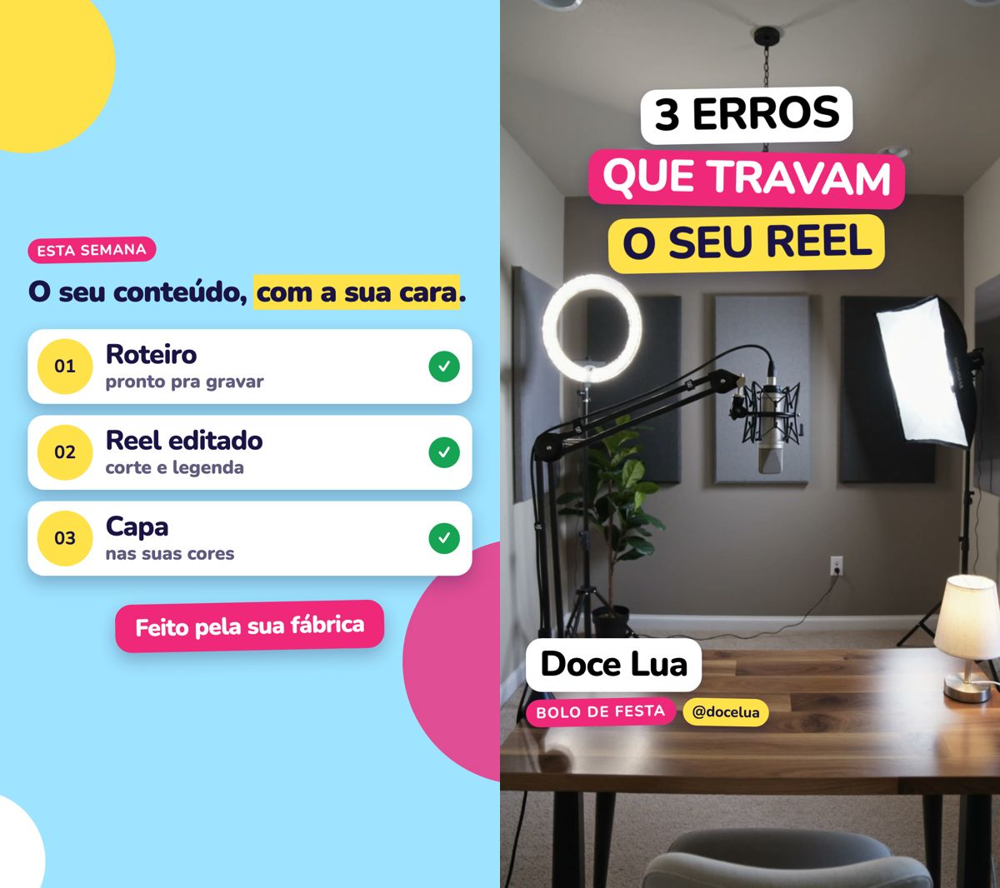

Colorido e redondo. Chão de cor viva com bolhas grandes nos cantos, cartão branco sem
borda flutuando numa sombra macia, a Nunito bem gorda e a etiqueta em pílula.

```
adapta a fábrica pra minha marca, seguindo o docs/guia-de-estilos.md: estilo pop, cores #9EE3FF #1A1446 #F0287A #FFE14A, letra Nunito. Sobre mim: <o que você vende, pra quem, e o seu jeito de falar em três palavras>
```

### Luxo

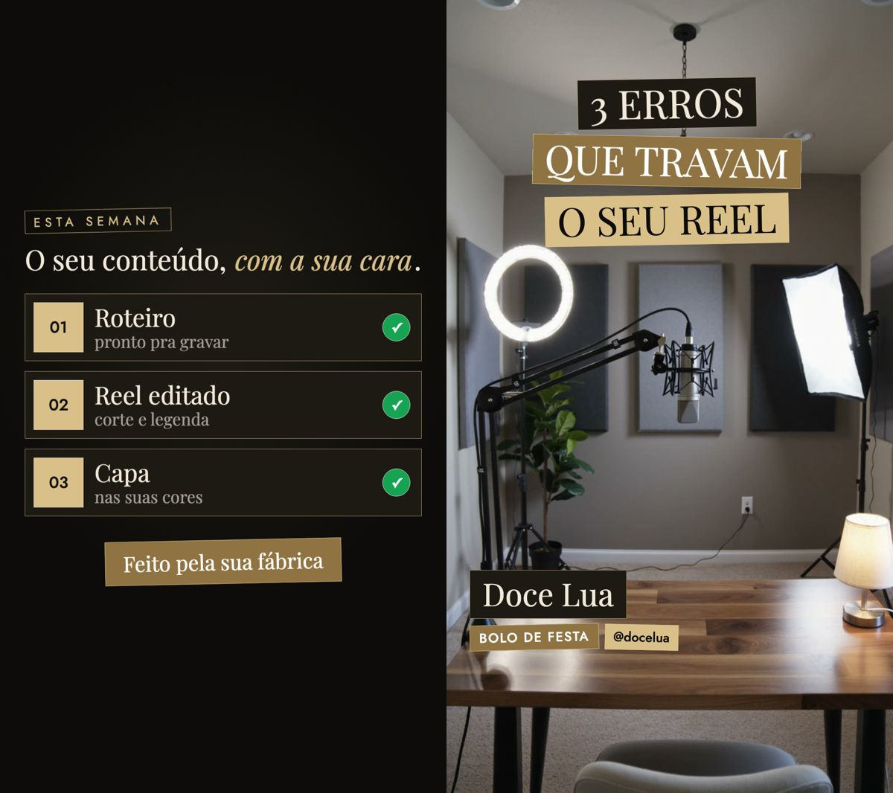

Sóbrio: preto, creme e dourado. A Playfair Display leve, filete dourado fino no lugar da
borda, canto reto e nenhuma sombra. O destaque é itálico dourado, e a etiqueta é texto bem
espaçado dentro de um filete.

```
adapta a fábrica pra minha marca, seguindo o docs/guia-de-estilos.md: estilo luxo, cores #0D0C0A #F1E9DA #8F7342 #D9C089, letra Playfair Display. Sobre mim: <o que você vende, pra quem, e o seu jeito de falar em três palavras>
```

### Cyberpunk

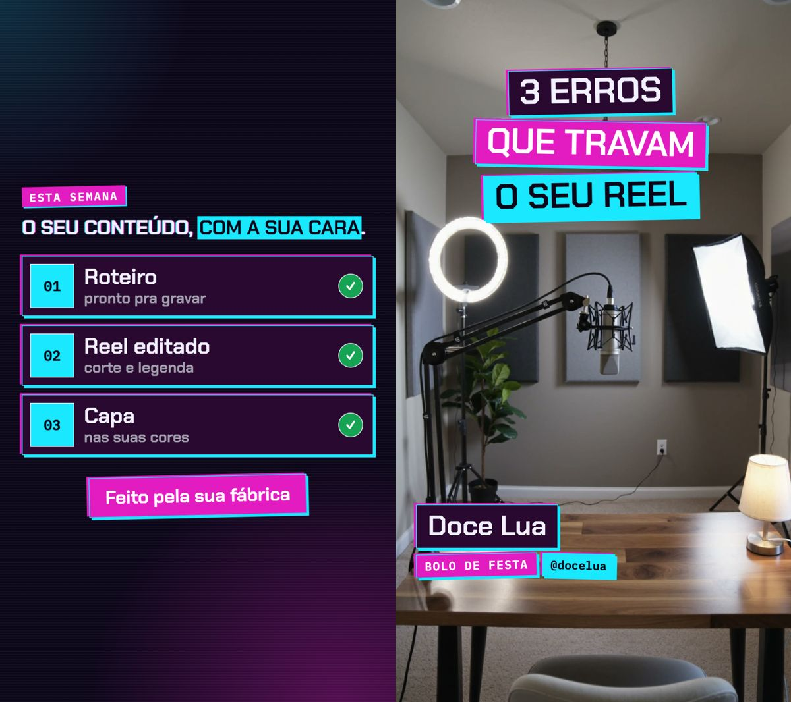

Noite de neon. Chão roxo-preto com linhas de varredura, título em caixa alta na Chakra
Petch, com a cor separada em magenta e ciano, e cada objeto com a sombra dobrada nas duas
cores, como imagem com defeito.

```
adapta a fábrica pra minha marca, seguindo o docs/guia-de-estilos.md: estilo cyberpunk, cores #0B0618 #F3F0FF #E21CC0 #19E8FF, letra Chakra Petch. Sobre mim: <o que você vende, pra quem, e o seu jeito de falar em três palavras>
```

### Pixel

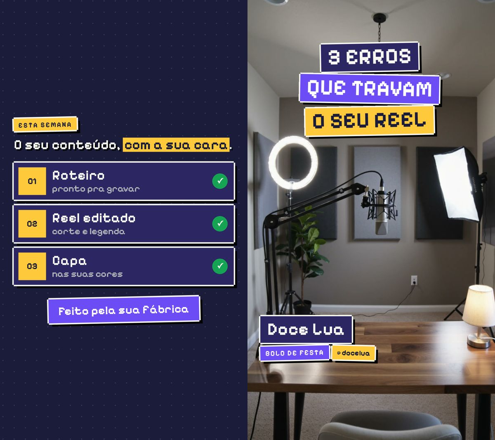

Tela de jogo de 8 bits, sem personagem nem marca de ninguém. Chão azul-noite com pontos de
grade, a Pixelify Sans, caixa de diálogo com o canto em degrau e sombra preta seca.

```
adapta a fábrica pra minha marca, seguindo o docs/guia-de-estilos.md: estilo pixel, cores #1A1C3A #F7F7F2 #6C4CF5 #FFC93C, letra Pixelify Sans. Sobre mim: <o que você vende, pra quem, e o seu jeito de falar em três palavras>
```

### Quadrinhos

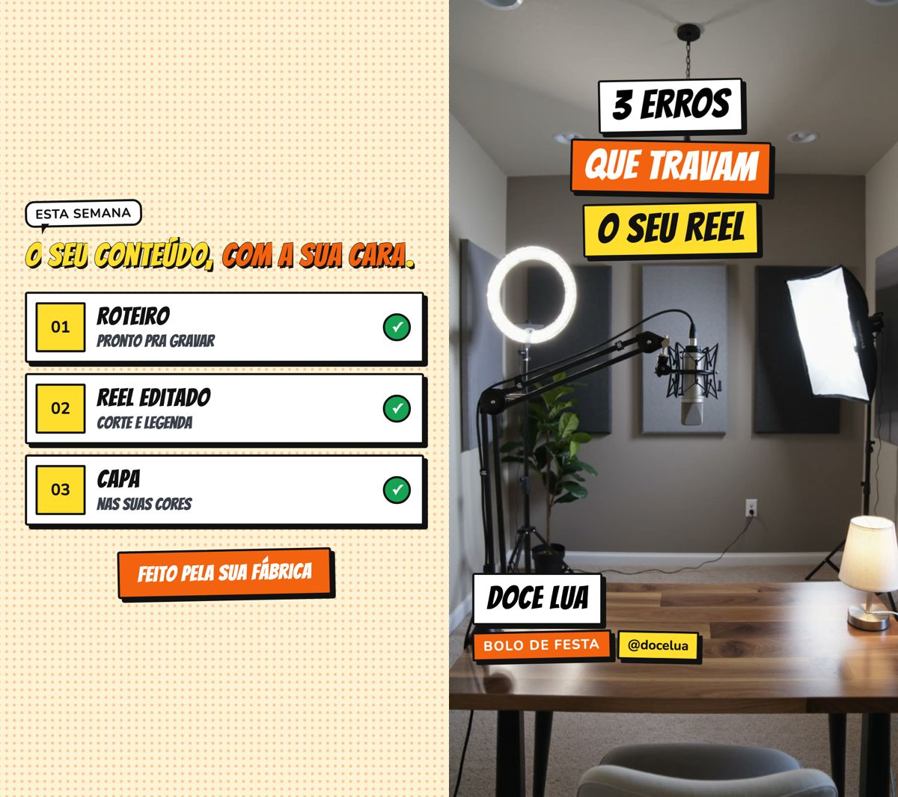

Página de gibi. Papel jornal com retícula de pontos, contorno preto bem grosso, título na
Bangers, amarelo com contorno e sombra preta, e a etiqueta como balão de fala.

```
adapta a fábrica pra minha marca, seguindo o docs/guia-de-estilos.md: estilo quadrinhos, cores #FFF3D6 #111111 #F2620F #FFDE2E, letra Bangers. Sobre mim: <o que você vende, pra quem, e o seu jeito de falar em três palavras>
```

### Vaporwave

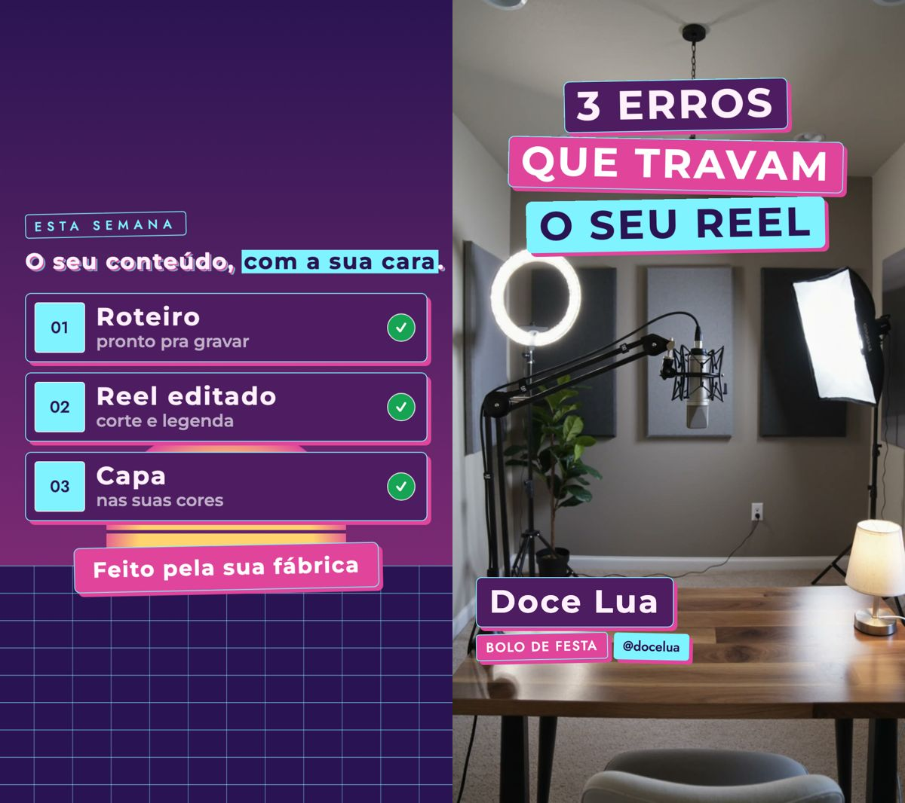

Pôr do sol de computador antigo. Céu roxo descendo pro rosa, um sol listrado e o chão em
grade. Cartão roxo de filete ciano com sombra rosa, e a Montserrat larga e espaçada.

```
adapta a fábrica pra minha marca, seguindo o docs/guia-de-estilos.md: estilo vaporwave, cores #2A1352 #FFF0FB #E0459B #7FF3FF, letra Montserrat. Sobre mim: <o que você vende, pra quem, e o seu jeito de falar em três palavras>
```

### Lousa

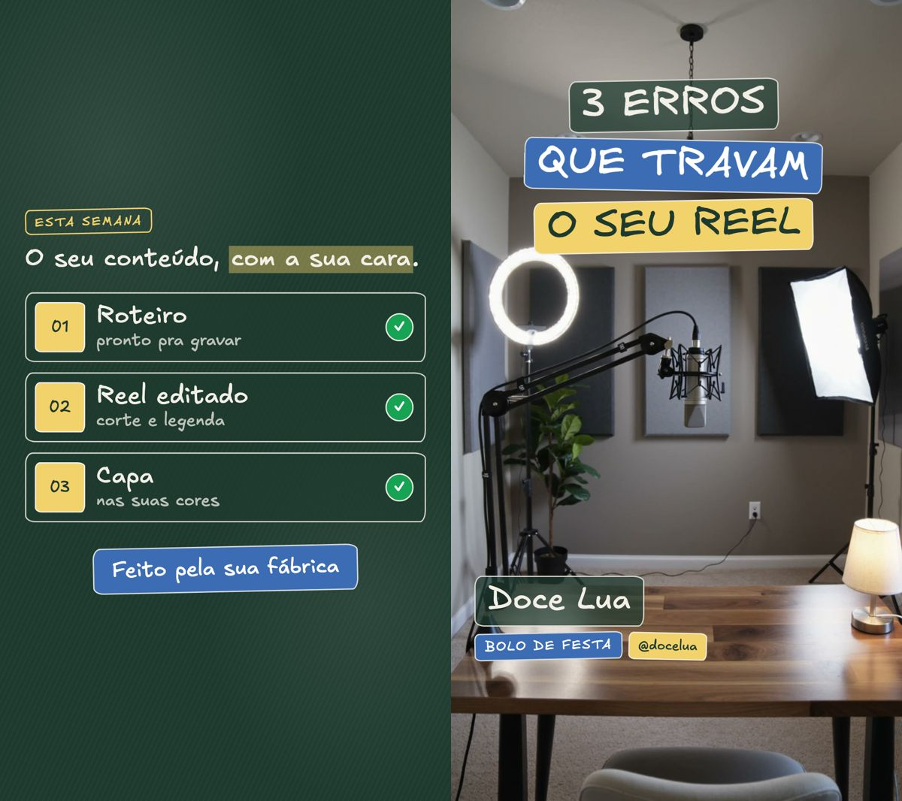

Quadro-negro de sala de aula. Verde-escuro com pó de giz, letra escrita à mão (Excalifont),
e o objeto é só o contorno em giz, torto como quem desenhou na hora. O destaque é giz
amarelo por cima da palavra.

```
adapta a fábrica pra minha marca, seguindo o docs/guia-de-estilos.md: estilo lousa, cores #1E3A2F #F2EFE6 #3C6DB4 #F2D26B, letra Excalifont. Sobre mim: <o que você vende, pra quem, e o seu jeito de falar em três palavras>
```

### Colagem

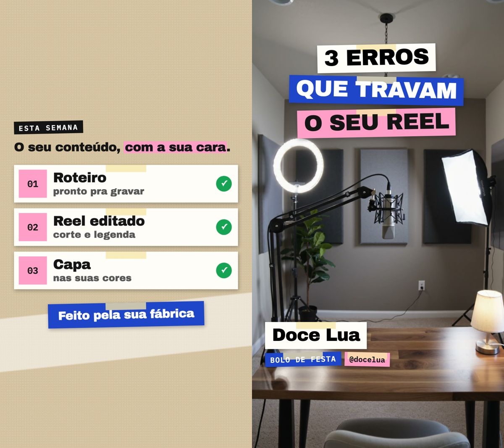

Recorte sobre papel pardo. Uma faixa de papel rasgado atravessa o fundo, o objeto é papel
branco colado com fita, o título é a Archivo Black, a etiqueta é fita de rotuladora e o
destaque é marca-texto.

```
adapta a fábrica pra minha marca, seguindo o docs/guia-de-estilos.md: estilo colagem, cores #D6C4A2 #141414 #1F45C8 #FF9FC8, letra Archivo Black. Sobre mim: <o que você vende, pra quem, e o seu jeito de falar em três palavras>
```

## As quatro cores

Todo estilo usa quatro cores, cada uma com um papel:

| Papel | Onde aparece | A regra |
|---|---|---|
| Chão | o fundo das peças e do painel | nos estilos claros, a mais clara; nos escuros, a mais escura |
| Letra | o texto e a borda dos cartões | tem que ler bem em cima do chão |
| Bloco | o que a pessoa recebe: o botão, o cartão de destaque | a cor forte da sua marca. Leva letra branca em cima |
| Marcador | a palavra grifada, a etiqueta | uma cor viva, diferente do bloco |

Nos estilos de chão escuro (tech, luxo, cyberpunk, pixel, vaporwave e lousa), a letra é a
cor clara, e o cartão sai do próprio chão, um tom acima. Em cima do marcador vai a letra
escura do chão, então o marcador tem que ser claro.

Verde e vermelho a fábrica guarda pra sinal: verde confirma, vermelho marca custo ou
perda. Não precisa pôr na paleta.

## As letras

Toda letra dos estilos já vem na fábrica, em `tools/video-use/assets/fontes/`, com a
licença ao lado: são todas livres, inclusive pra vídeo vendido. Quer outra? Peça pelo nome
de uma letra livre do Google Fonts, e o agente baixa com a licença.

## As cores no Coolors

O Coolors (coolors.co) gera paletas de graça.

1. Abra coolors.co e clique em "Start the generator".
2. Aperte a barra de espaço: cada toque traz uma paleta nova.
3. Já tem a cor da sua marca? Clique no código de uma das cores, digite o da sua e
   clique no cadeado da coluna. A barra de espaço passa a trocar só as outras, e as novas
   combinam com a sua.
4. Trave as que gostar e siga apertando o espaço até ter quatro que você usaria. A
   paleta vem com cinco: apague uma no X da coluna.
5. Confira a leitura no Contrast Checker (coolors.co/contrast-checker): branco por cima
   do bloco, e a letra escura por cima do marcador. Os dois têm que passar em "Large
   text"; passar também em "Small text" é melhor ainda.
6. Copie o endereço da página. Ele termina com os códigos das cores
   (coolors.co/fffffe-0b0d12-...), e o agente lê as cores dali. Ou copie os códigos um
   por um, com o # na frente.

## O pedido

Cole no seu agente de IA, aberto na pasta da fábrica. Troque o que está entre `< >`:

```
adapta a fábrica pra minha marca, seguindo o docs/guia-de-estilos.md: estilo <nome do estilo>, cores <o endereço do Coolors ou os quatro códigos>, letra <a do estilo ou outra>. Sobre mim: <o que você vende, pra quem, e o seu jeito de falar em três palavras>
```

Um exemplo preenchido:

```
adapta a fábrica pra minha marca, seguindo o docs/guia-de-estilos.md: estilo pop, cores https://coolors.co/fff4e6-3d1f2b-d9376e-ffc93c, letra Nunito. Sobre mim: vendo bolo de festa por encomenda em Niterói, pra quem organiza aniversário de criança; meu jeito é carinhoso, animado e direto
```

O agente monta a pasta `marca/` e copia as letras. Se uma cor não dá leitura, ele avisa e
propõe o tom mais perto. No fim, te mostra uma amostra e um vídeo curto com a cara nova,
sem cobrar nada. Os pedidos dos próximos vídeos, já com o nome da sua marca, ficam em
`marca/PEDIDOS.md`.

Quer mudar depois? Peça de novo com outro estilo ou outras cores. A marca velha fica
guardada com a data.

## Para o agente

O passo a passo está na skill `fabrica-estilo`, seção "A marca feita aqui". O tema de
cada estilo é o arquivo `docs/guia-de-estilos/<estilo>.css` (`neobrutalista`,
`editorial`, `tech`, `retro`, `pop`, `luxo`, `cyberpunk`, `pixel`, `quadrinhos`,
`vaporwave`, `lousa`, `colagem`). As letras dele são os `url(fontes/...)` do topo, e cada
arquivo está em `tools/video-use/assets/fontes/`.
